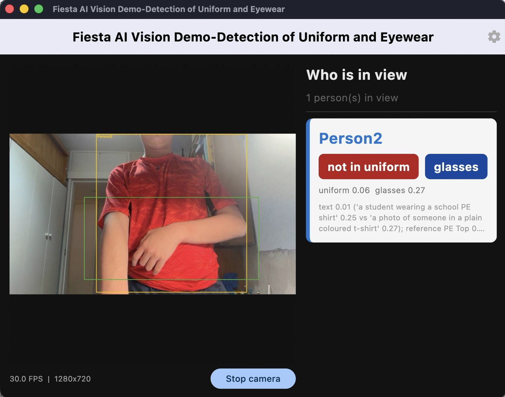

# Fiesta AI Vision Demo-Detection of Uniform and Eyewear

Author: David Li, SISHK

## Contents

1. [What is this project about?](#1-what-is-this-project-about)
2. [How to use this project](#2-how-to-use-this-project)
3. [Modules and AI models to download and install](#3-modules-and-ai-models-to-download-and-install)
4. [How it works](#4-how-it-works)
5. [Tuning at the fair](#5-tuning-at-the-fair)
6. [Glasses: what actually works](#6-glasses-what-actually-works)
7. [What we learned from `schooluniform`](#7-what-we-learned-from-schooluniform)
8. [Tests](#8-tests)
9. [Packaging](#9-packaging)

---

## 1. What is this project about?

A **Flet + computer-vision demo for the SISHK STEM fair**. The laptop webcam
watches the room and, for each person in front of it, decides two things:

- **Uniform**: is this person wearing the school uniform? (green / red / orange)
- **Eyewear**: are they wearing glasses? (blue / grey / orange)

Each person appears as `Person1`, `Person2`, ... with a coloured name, a large
status badge for each question, and the score that produced it. Nothing is
recorded, no faces are recognised, no names are stored - the camera image only
travels from OpenCV to the preview inside the app.

Everything runs **locally on the MacBook** (target: MacBook Air M4, 1280×720
webcam). There are no cloud calls:

| Stage | Model | Runs on |
|---|---|---|
| find people | YOLO11n ONNX | CoreML (ONNX Runtime) |
| compare the shirt with the school uniform | MobileCLIP2-B ONNX | CPU (~80 ms/crop) |
| find the face + eyes | OpenCV YuNet | CPU (~10 ms) |

What you see while it runs:

- **Left (60 %)**: the live preview with a yellow person box, a green shirt box,
  and a blue eye box.
- **Right (40 %)**: one card per judged person, full height, with big badges.
- **Terminal**: every verdict and score (`p=...`), so a wrong call is explainable.



The app degrades instead of crashing when something is missing: no YOLO means no
people, no CLIP means the colour check still gives a uniform verdict and glasses
stay `unknown`.

---

## 2. How to use this project

### 2.1 Requirements

- macOS on Apple silicon (developed on an M4), a working webcam.
- Python **3.13**.
- Camera permission for your terminal:
  **System Settings → Privacy & Security → Camera**.
- ~600 MB of disk for the AI models (see section 3).

### 2.2 Install

**On this Mac** the dependencies live in the shared venv one level up, so there
is nothing to install to run it:

```bash
../myvenv/bin/flet run          # desktop window
../myvenv/bin/flet run --web    # browser
../myvenv/bin/python -m pytest -q
```

**On a fresh machine** (or if you prefer an isolated environment):

```bash
uv sync                 # runtime + dev dependencies from pyproject.toml
uv run flet run         # desktop
uv run flet run --web   # browser
```

On Windows the helper scripts point at the shared venv:

```bat
run.bat          :: desktop window
run-web.bat      :: browser
test.bat         :: fast test suite
```

The **AI models are not in git** (they are ~600 MB). Section 3 explains how to
download/export them once per machine. Until then the app still starts and shows
a banner listing what is missing.

### 2.3 Run and use

1. Start the app (commands above). The window opens with
   `Press 'Start camera' to begin` - **the webcam is never opened by itself**.
2. Press **Start camera**. The button becomes **Stop camera**; press it again to
   stop (the preview freezes on a placeholder and tracks reset).
3. Walk into the frame. A card appears within ~0.5 s and is **decided about
   1.5-2 s after you enter**: the app deliberately shows `checking...` until two
   checks have been taken and then publishes the median of the recent checks, so
   you never see a wrong verdict flash and then correct itself.
4. Open **Settings** with the gear in the app bar. The panel slides in under the
   video (the status panel keeps its full height) and has two live sliders:
   - **Uniform match threshold** (default 0.50): raise it if casual clothes pass,
     lower it if the school shirt does not.
   - **Glasses sensitivity** (default 0.25): lower it if your glasses are missed;
     thin/rimless frames usually need 0.05-0.10.
5. Watch the terminal while you stand in front of the camera. Each check prints
   the published value and the raw sample:

   ```
   [detect] 1 judged of 2 detected (15% area gate) | YOLO scores: 0.94, 0.87
   [detect] Person1: uniform=not in uniform p=0.30 (sample 0.59) | glasses=glasses p=0.59 (sample 0.66)
              text 0.05 ('a student wearing a school PE shirt' 0.28 vs 'a plain t-shirt' 0.33)
              reference PE Top 0.48 -> 0.36 | no uniform match (0.30; white 0.11, red 0.10)
   ```

   `p=` is what the card shows (median); `sample=` is that single crop. The two
   glasses numbers in brackets are the face crop and the eye band.

### 2.4 Demo-day checklist

1. Camera permission granted to the terminal (see 2.1).
2. Models present - `ls src/assets/models/` should list all 7 files (section 3.4).
3. Start the app, press **Start camera**.
4. Light from the front; avoid a bright window behind the person.
5. Stand at ~1-2 m so the box is comfortably above 15 % of the frame.
6. If a verdict is wrong for you, adjust the matching slider and read the `p=`
   value in the terminal - that number is the truth, the label is just a
   threshold on it.

### 2.5 If something goes wrong

| Symptom | Cause / fix |
|---|---|
| Banner lists `yolo11n.onnx` / CLIP / YuNet missing | models were never exported on this machine → section 3 |
| "camera 0 could not be opened" | terminal has no Camera permission, or another app (Zoom, Photo Booth, Chrome) holds the camera |
| Preview flickers or blinks | `gapless_playback` off, duplicate frames pushed, or two reader threads - all three are handled in `views/app_view.py` + `services/camera.py`; if it still flickers check the FPS readout (should be ~30; 2 FPS means a slow negotiated format) |
| `RuntimeError: An attempt to fetch destroyed session` on close | fixed: the loops stop on a destroyed session (`_safe_update`) |
| `value (0.85...1) must be less than or equal to max (0.85)` | fixed: slider control maxes carry a float margin and the handlers clamp (`UNIFORM_THRESHOLD_MAX`, `GLASSES_THRESHOLD_MAX`) |
| Card stuck on `checking...` | the person is below the 15 % area gate, or no face/model is available; the terminal line shows why |

---

## 3. Modules and AI models to download and install

### 3.1 Python modules

Runtime (needed to run the app) - already in `pyproject.toml`:

| Package | Why |
|---|---|
| `flet>=1.0` | UI, app bar, preview, sliders |
| `opencv-python>=4.10,<5` | webcam capture, YuNet, crops, JPEG encode |
| `onnxruntime>=1.20` | runs the three ONNX models (CoreML + CPU) |
| `numpy>=2.0` | tensors, cosine similarity |
| `pillow>=11.0` | image assets |

Export only (one-time, to create the ONNX files - **not** needed at runtime):

| Package | Why |
|---|---|
| `torch>=2.4`, `torchvision` | export MobileCLIP2 to ONNX, run YOLO export |
| `ultralytics>=8.3` | downloads `yolo11n.pt` and exports it |
| `open-clip-torch>=2.26` | loads `timm/MobileCLIP2-B-OpenCLIP` |
| `transformers>=4.40` | the CLIP tokenizer (needed for the prompt banks) |

Dev (tests): `flet[test]`, `pytest`, `pytest-asyncio` - part of `uv sync`.

Install for a fresh clone:

```bash
uv sync                    # runtime + dev
uv sync --group export     # add the export toolchain to the project venv
```

### 3.2 AI models

All models live in `src/assets/models/` (git-ignored, ~582 MB total):

| File | Role | Size | Source / licence |
|---|---|---|---|
| `yolo11n.onnx` | finds people (COCO class 0) | ~10 MB | exported from Ultralytics YOLO11n (AGPL-3.0) |
| `face_detection_yunet_2023mar.onnx` | face box + 5 landmarks for the eye band | ~230 KB | OpenCV Zoo (Apache-2.0), downloaded |
| `mobileclip2_b_vision.onnx` | image encoder for uniform + glasses | ~350 MB | `timm/MobileCLIP2-B-OpenCLIP` (Apple `apple-amlr` weights) |
| `mobileclip2_b_vision.json` | that encoder's mean/std/image size | tiny | written by the export |
| `mobileclip2_b_text.onnx` | text tower (export only, app never loads it) | ~254 MB | same checkpoint |
| `uniform_prompts.npy` + `.json` | pre-computed text vectors (10 uniform / 11 casual) | ~40 KB | generated |
| `glasses_prompts.npy` + `.json` | pre-computed text vectors (10 glasses / 7 bare) | ~35 KB | generated |

Runtime uses only **YOLO + YuNet + the vision tower + the prompt vectors**
(~360 MB in memory); the text tower exists so the prompt banks can be regenerated.

### 3.3 Getting the models (once per machine)

The export script downloads YuNet, downloads the YOLO11n weights, exports it to
ONNX, downloads MobileCLIP2-B (~500 MB) from Hugging Face and exports both
towers, then writes the prompt banks:

```bash
# throwaway environment so the app runtime never gains torch
uv venv --python 3.13 .export-venv
VIRTUAL_ENV=.export-venv uv pip install torch torchvision ultralytics open-clip-torch transformers
.export-venv/bin/python scripts/export_models.py
rm -rf .export-venv            # safe: the models are already in src/assets/models
```

On the Windows machine the same script runs in the shared venv:

```bat
"C:\Users\david\OneDrive\Python Coding\myvenv\Scripts\python.exe" scripts\export_models.py
```

Notes:

- Run it **once per machine**; it is idempotent (YuNet is skipped if present,
  everything else is overwritten).
- It needs network access only for that first run (Ultralytics assets + Hugging
  Face), then the demo works offline.
- `uv run --group export python scripts/export_models.py` does the same thing
  inside the project venv if you prefer.

### 3.4 Verify the install

```bash
ls -lh src/assets/models/
```

Expected (all 7):

```
face_detection_yunet_2023mar.onnx    ~230 KB
glasses_prompts.json / .npy          ~35 KB
mobileclip2_b_text.onnx              ~254 MB
mobileclip2_b_vision.json            tiny
mobileclip2_b_vision.onnx            ~350 MB
uniform_prompts.json / .npy          ~40 KB
yolo11n.onnx                         ~10 MB
```

Then start the app: with every model present the banner stays empty. If a note
appears, it names the missing file.

### 3.5 Calibrate the thresholds to your own photos

No extra modules needed (runtime only), ~20 s:

```bash
python scripts/calibrate.py \
    --uniform "src/assets/Reference Photos" --casual ~/Pictures/casual \
    --glasses-with ~/Pictures/glasses --glasses-without ~/Pictures/no-glasses
```

It prints every score, the best separating threshold (Youden's J) and what the
shipped defaults would produce, so a threshold is a measurement rather than a
guess. More uniform photos (people **wearing** it, not flat product shots) are
the single biggest accuracy improvement.

---

## 4. How it works

```
src/
  main.py                      ft.run(main), wires page -> controller
  models/                      no Flet imports, all unit tested
    constants.py               every threshold in one place
    geometry.py                letterbox, IoU, NMS, torso/eye/face boxes
    person_detector.py         YOLO11n ONNX session + decode_yolo
    tracks.py                  IoU tracking, 3-hit confirmation, pose-aware torso band
    uniform.py                 P(uniform) from prompt level x gap + reference photos
    face.py                    YuNet wrapper, face_box(), pick_face()
    glasses.py                 face + eye-band views -> P(glasses)
    clip.py                    ONNX CLIP encoder, prompt bank, calibration helpers
    status.py                  tracks -> Person N rows, warm-up + median verdict
    frames.py                  JPEG preview + box drawing
  services/
    camera.py                  OpenCV grabber thread (latest frame wins)
    assets.py                  FLET_ASSETS_DIR / src/assets resolution
  views/app_view.py            app bar, 60/40 layout, settings panel
  controllers/app_controller.py camera button + two async loops (12/6 fps)
scripts/
  export_models.py             one-time YOLO/YuNet/MobileCLIP2 export (+ prompts)
  calibrate.py                 score your own photos, print the best threshold
```

Design rules worth keeping:

- **The camera starts on the button**, never on launch.
- **Detection runs at ~6 fps, not per frame.** Classifiers run once per person
  and are cached for 5 s, or until the person moves / changes size by more than
  20 % of their box height.
- **The 15 % area rule is a display filter, not an optimisation.** The detector
  has already run by the time a box exists; the tracker sees every detection and
  the gate only decides who is judged/shown (15 % to enter, 12.75 % to leave).
- **A verdict is the median of recent checks**, held as `checking...` until two
  samples exist. Live logs showed the same person scoring 0.15 / 0.59 / 0.30 as
  the crop shifted; the median settles instead of flipping the card.
- **Boxes are glued to the face.** YuNet runs once per detection frame so the
  blue eye box follows a moving head, and every box is clipped to the face and
  to the frame.
- **Glasses never guesses, and answers fast.** Too small / no model / borderline
  → `unknown` or `unsure`; a decisive first sample (≥ 0.55 or ≤ 0.05) is
  published immediately and a clearly positive face view skips the eye-band pass.

Timings measured on the M4 (1280×720): YOLO 11 ms, YuNet 37 ms, preview JPEG
5 ms, uniform CLIP 80 ms, glasses 78-154 ms → **~0.24 s per person check**.

---

## 5. Tuning at the fair

The gear button in the app bar opens **Settings** underneath the camera video
(the preview shrinks, the status panel keeps its full height). Two sliders, both
re-checking everyone immediately:

- **Uniform match threshold** (default 0.50, range 0.30-0.85): P(uniform) above
  this is "in uniform".
- **Glasses sensitivity** (default 0.25, range 0.02-0.60): lower = finds more
  glasses.

`src/models/constants.py` holds the rest: confidence, IoU, area gate, torso crop
ratios, preview size/fps, minimum crop sizes, and `RECLASSIFY_INTERVAL` (5 s -
how often a standing person's verdict is refreshed).

Reference uniforms are read from any `src/assets/reference*` folder
(`Reference Photos` today).

---

## 6. Glasses: what actually works

Measured on this Mac with 13 public portraits **and** live webcam logs (thin and
rimless frames included) - the same stack the sibling project used:

| View | Result |
|---|---|
| tight eye strip only | no better than chance (Youden J 0.00) |
| whole face crop only | separates, but misses thin frames and keeps 1 false positive (a hand/mic near the face, p=0.21) |
| one blurry view + one clear view | the blurry one must not veto (face 0.42 x eye 0.00 fused to 0.04 "no glasses") |

So the classifier scores both views and takes the **higher** probability. On the
spot check that detects 5 of 8 wearers (0.25-0.82) with the worst bare face at
0.21 - below the 0.25 threshold.

Known limits, stated rather than hidden:

- Thin wire/rimless frames can score ~0.00 and are missed. Lower the slider to
  0.05-0.10 if that is your face.
- Faces smaller than 48 px make the verdict `unknown` (never a guess); the eye
  band needs only 24 px because it is short by nature.
- A face must be found by YuNet first; profile views and masks fail there.

---

## 7. What we learned from `schooluniform`

https://github.com/yunguangli/schooluniform runs the same models (YOLO11n +
MobileCLIP2-B + YuNet) and documents its measurements. We adopted the ones that
transfer and replaced the ones that did not:

| Finding there | Here |
|---|---|
| Crop quality beats model size; a fixed torso band crops the face on close-ups | Two bands by pose: close-up 40-92 %, full body 12-62 %, plus 8 % side margin |
| A partial first box produces a wrong crop | 3 hits + 0.8 s settle before the first check (stricter: they use 2 hits) |
| Track every detection, mark far people instead of dropping boxes | Adopted; the 15 % gate only controls judging/display, with hysteresis |
| Largest face inside the person box wins | Adopted (replaces "nearest the head area") |
| Verdict cache: 10 s TTL, or shift **or size change** > 20 % of height | Adopted both, TTL 5 s; walking toward the camera also re-checks |
| Face crop (+margin) beats the eye strip for glasses | Both views scored, the higher one wins |
| Two explicit Start/Stop buttons | One async toggle, disabled while opening, one retry for macOS |
| Publish the first verdict immediately | **Not** adopted: live log flapped 0.15 / 0.59 / 0.30; we publish the median |
| CoreML EP for ONNX | YOLO keeps CoreML; MobileCLIP2 runs on CPU (170 ms vs 400 ms with CoreML partitioning) |
| Prompt sets: 8 uniform / 9 casual / 4+3 glasses | Adopted, plus the school-specific red-trim and thin-frame prompts |

Where we deliberately differ on scoring: they use a temperature-100 softmax over
the *gap* between the best uniform and casual prompt. The gap alone is not enough
here (an ordinary portrait with u=0.22, c=0.21 gives a confident 0.73) and the
level alone is not enough either (a white casual top matched "school PE shirt" at
u=0.30, exactly like a real uniform). We multiply **level x gap**, then blend that
with the reference-photo cosine **65/35** - a reference cosine of 0.56 against the
product cut-outs must not outvote prompts that say "casual". Replaying a live log
through this gives the casual top 0.23-0.31 on every sample (correctly "not in
uniform") and the real PE uniform 0.94-0.99.

Two things they listed as not-yet-wired are implemented here: the shirt crop is
anchored below the detected chin, and the glasses verdict takes the better of two
views.

---

## 8. Tests

```bash
../myvenv/bin/python -m pytest -q     # fast suite, no Flutter needed
```

107 tests cover geometry, tracking, warm-up/median, the classifier rules, the
camera thread lifecycle, the app bar/layout and the Flet wiring. `tests/test_main.py`
is an `integration` test that drives a Flutter test host, so it is skipped unless
run through `flet test` or with `FLET_RUN_INTEGRATION=1` (never define your own
`flet_app` fixture - the flet pytest plugin injects it).

---

## 9. Packaging

```bat
myvenv\Scripts\flet.exe build macos -v
```

macOS apps need `NSCameraUsageDescription` in `Info.plist` (Flet adds it when the
camera permission is requested; for a packaged build add it explicitly).
`flet_camera` is deliberately not used: it raises
`FletUnsupportedPlatformException` on desktop, so OpenCV is the only path that
works on the MacBook.